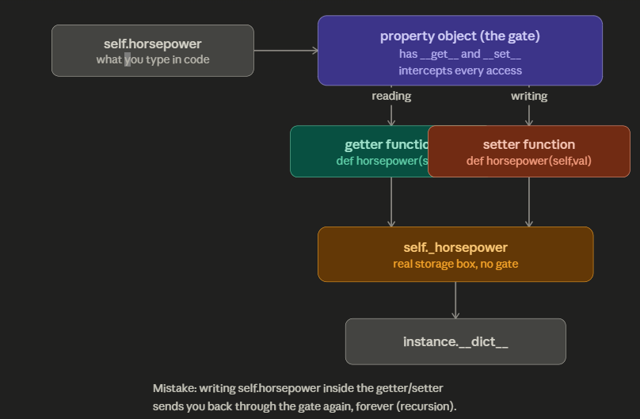

# 🔐 The `@property` Decorator

A **property** lets a method be used like a plain attribute (no parentheses), often to add validation or computation.

---

## 🧩 The Three Components of a Property

| Component | Decorator | Runs when... |
| :--- | :--- | :--- |
| **Getter** | `@property` | A user **reads** the value (`obj.name`) |
| **Setter** | `@name.setter` | A user **assigns** a value (`obj.name = x`). Lets you validate data before saving it. |
| **Deleter** | `@name.deleter` | A user runs `del obj.name` (used rarely to clean up memory or block deletion). |

---

## 🤔 Why Use Properties?

Normally, if you let users change a variable directly, they can break your code by inputting bad data:

```python
# ⚠️ The danger: someone can give a car a negative horsepower value
my_car.horsepower = -500
```

Properties solve this by acting as a **gatekeeper**. They let you intercept that action, check whether the data is valid, and reject it if it isn't.

---

## 🖼️ How It Works Under the Hood



* `self.horsepower` — what you type in code.
* The **property object** is the gate — it has `__get__` and `__set__` and intercepts every access.
* Reading goes through the **getter** (`def horsepower(self)`); writing goes through the **setter** (`def horsepower(self, value)`).
* Both ultimately read/write `self._horsepower` — the real storage box, with no gate.
* That, in turn, lives in `instance.__dict__`.

> [!WARNING]
> **Common mistake**: writing `self.horsepower` *inside* the getter/setter sends you back through the gate again — forever (infinite recursion). Always read/write the private `self._horsepower` inside the getter and setter, never `self.horsepower`.

See [property_example.py](file:///d:/python/python-study-notes/OOP%20-%20Classes/property_example.py) for a runnable example.
