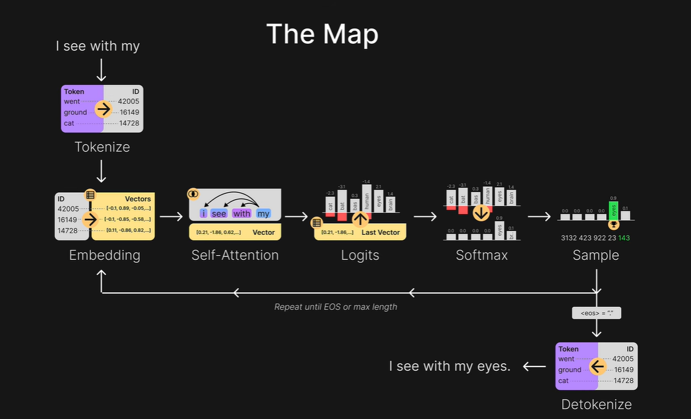
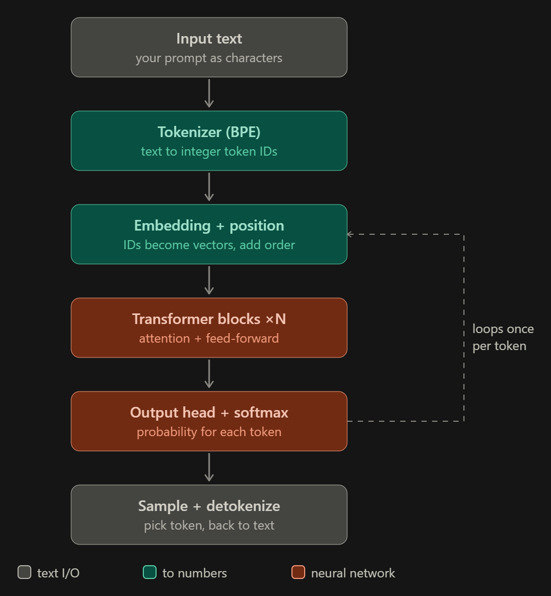
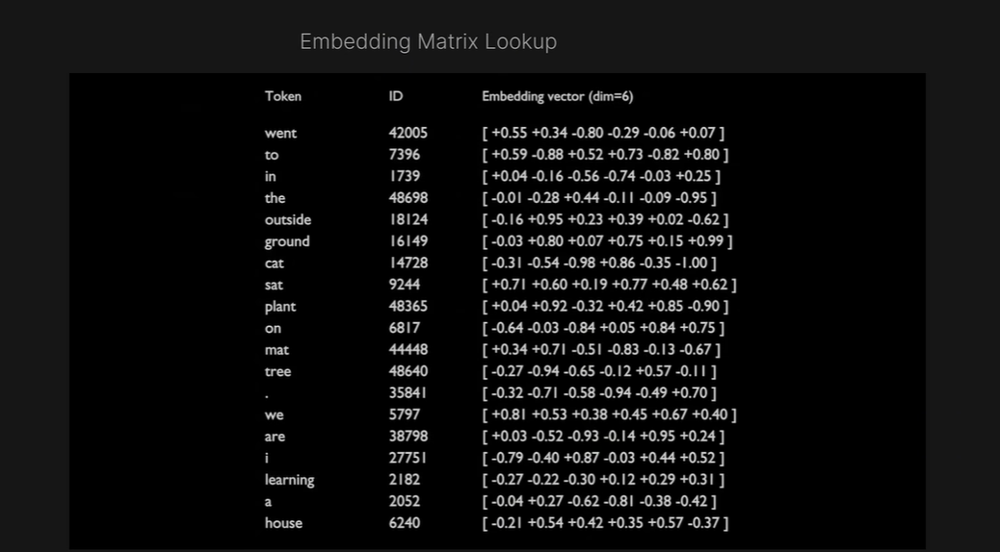
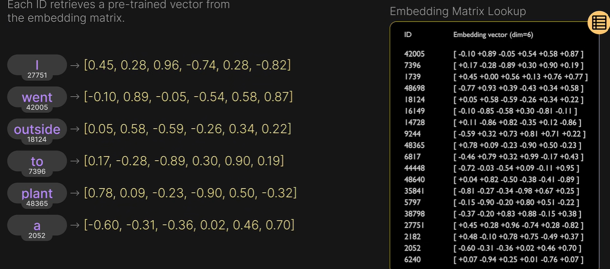
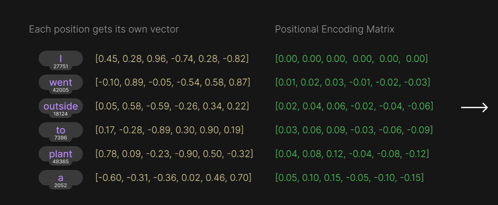
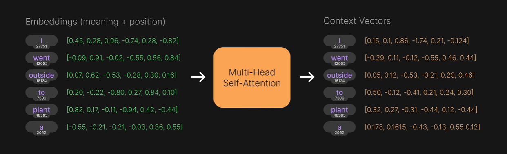
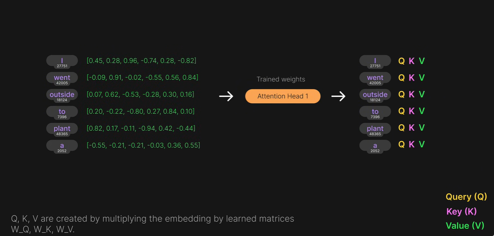
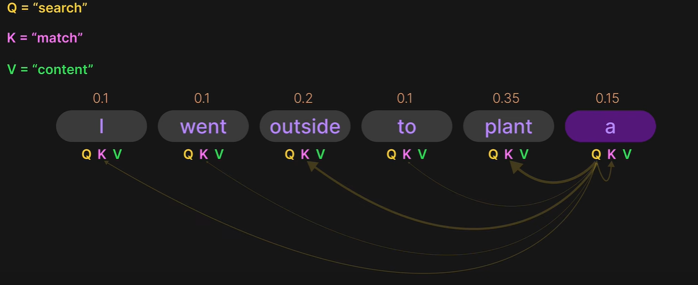

# LLM Architecture

## Overall Flow Explanation

This is the full journey of a prompt through a Large Language Model (LLM), from raw text in to raw text out.

**Tokens** are the single most important concept for understanding how an LLM actually runs. Everything the model does happens in **token space**, not text space: your text is converted to token IDs, the model works only on numbers, and the final output is converted back to text.

  

<em>Figure 1: The Map — the full flow for the prompt "I see with my" → "I see with my eyes."</em>

  

<em>Figure 2: Simplified pipeline. The dashed arrow is the autoregressive loop, which runs once per generated token.</em>

---

## Step-by-Step

### 1. Input Text

You send a raw string, e.g. `"I love tokenization!"`. To the model this is just a sequence of characters (really bytes); it has no built-in notion of words.

### 2. Tokenization (BPE)

A tokenizer splits the text into **tokens** — chunks drawn from a fixed vocabulary (often ~30k–200k entries) — and maps each to an integer ID. This is a lookup/merge process, **not neural**.

Example: `"I love tokenization!"` might become 5 tokens → `[40, 1842, 6594, 2065, 0]` (the IDs here are illustrative).

### 3. Embedding

#### Why Embeddings?

Models can't work with words or raw IDs directly. A number like `27751` carries no meaning on its own, so each ID must be turned into a vector that does.

  

<em>Figure 3: Embedding matrix — every token ID maps to one learned vector (6 dimensions here, for readability).</em>

#### How It Works

Each token ID indexes into an **embedding matrix** (`vocabulary_size × d_model`). The ID becomes a dense vector (e.g. 4096 numbers) that encodes learned meaning. This is where integers finally become something the network can compute on.

  

<em>Figure 4: Each ID retrieves its pre-trained vector from the embedding matrix.</em>

### 4. Positional Information

Transformers process all tokens in parallel and have no inherent sense of order, so position data is injected (added positional encodings, or rotary/RoPE-style rotations inside attention).

With added positional encodings, each position gets its own vector, which is added element-wise to the token's embedding. For example, for `outside`: `[0.05, 0.58, -0.59, -0.26, 0.34, 0.22] + [0.02, 0.04, 0.06, -0.02, -0.04, -0.06] = [0.07, 0.62, -0.53, -0.28, 0.30, 0.16]`.

Now each token's vector carries both **what it is** and **where it is**.

  

<em>Figure 5: Each position gets its own vector (green), which is added to the token embedding.</em>

### 5. Transformer Blocks (×N)

The vectors pass through a stack of identically structured layers, each with its own learned weights (dozens to over a hundred layers). Each layer lets tokens exchange information via **self-attention** and then transforms each token individually with a feed-forward network. This is the bulk of the computation.

  

<em>Figure 6: Multi-head self-attention turns embeddings (meaning + position) into context vectors.</em>

#### Self-Attention

Self-attention is a mechanism where each token looks at the other tokens to decide which ones matter for its meaning.

It computes attention weights from Q and K, then uses them to blend the Value (V) vectors into a new **context vector** for each token.

So tokens are not isolated: each one carries information about its relationship to the other tokens in the sentence.

#### Query, Key, Value (Q, K, V)

Every token has three vectors: **Query (Q)**, **Key (K)** and **Value (V)**. They are created by multiplying the embedding by learned matrices `W_Q`, `W_K` and `W_V`.

  

<em>Figure 7: Q, K and V are produced from each embedding by trained weights.</em>

- **Query (Q):** What am I looking for?
- **Key (K):** How can other tokens match against me?
- **Value (V):** What information do I provide if I'm chosen?

Think of it as **Q = "search"**, **K = "match"**, **V = "content"**. The Query of one token is compared with the Key of every token to give attention weights (they sum to 1), and those weights decide how much of each token's Value is blended in.

  

<em>Figure 8: Attention weights for the token "a" — it attends most to "plant" (0.35) and "outside" (0.2).</em>

**Multi-head** attention runs several of these attention heads in parallel, each with its own `W_Q`, `W_K`, `W_V`, and combines their results.

### 6. Output Head (Unembedding)

The final layer's vector for the last position is projected back out to vocabulary size, producing one **logit** (a raw score) for every token in the vocabulary.

### 7. Softmax

Logits become a probability distribution — "how likely is each possible next token." **Temperature** rescales the logits before softmax, while **top-k** and **top-p** trim the distribution to the most likely tokens. Together they control randomness.

### 8. Sampling

One token is chosen from that distribution:

- **Greedy** — always pick the top one.
- **Sampling** — pick randomly, weighted by probability.

### 9. Autoregressive Loop

The chosen token is appended to the sequence, and steps 3–8 run again to produce the next token. The model generates **one token per forward pass**, feeding its own output back in, until it emits a stop token (EOS) or hits the length limit. This loop is the dashed arrow in Figure 2 (and the "Repeat until EOS or max length" arrow in Figure 1).

### 10. Detokenization

The generated token IDs are mapped back to text pieces and concatenated into the string you see.

---

## Quick Summary

| # | Stage | Input → Output | Learned weights? |
|---|-------|----------------|------------------|
| 1 | Input text | raw string | — |
| 2 | Tokenization (BPE) | text → token IDs | No (rule-based lookup/merge) |
| 3 | Embedding | IDs → vectors | Yes |
| 4 | Positional info | vectors → vectors with order | Depends (learned, or a fixed formula such as sinusoidal/RoPE) |
| 5 | Transformer blocks ×N | vectors → context vectors | Yes |
| 6 | Output head | last vector → logits | Yes |
| 7 | Softmax | logits → probabilities | No (a fixed math function) |
| 8 | Sampling | probabilities → one token | No |
| 9 | Autoregressive loop | append token, repeat 3–8 | — |
| 10 | Detokenization | token IDs → text | No |
